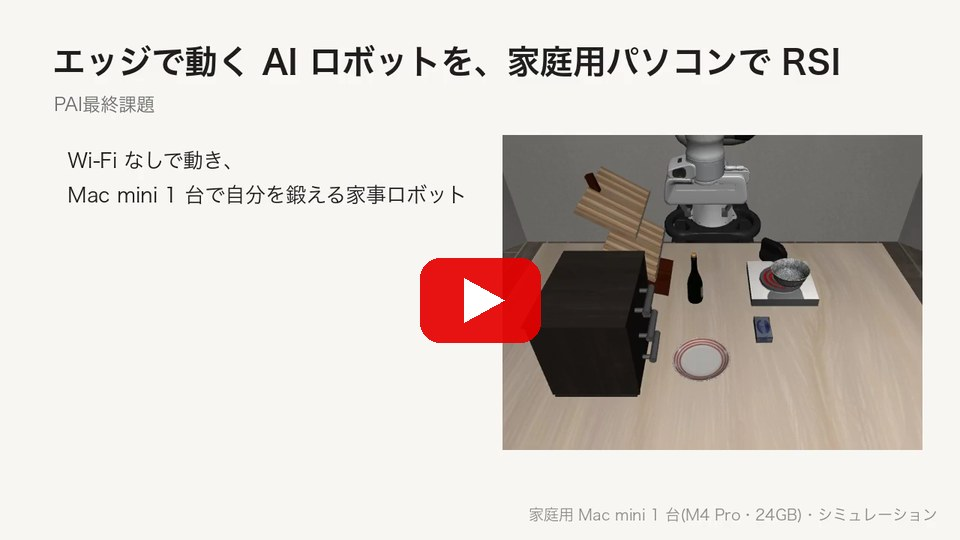
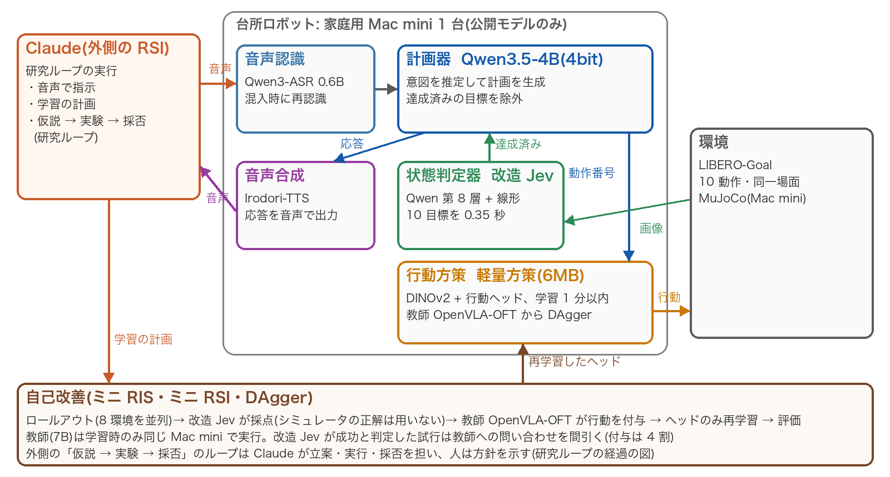
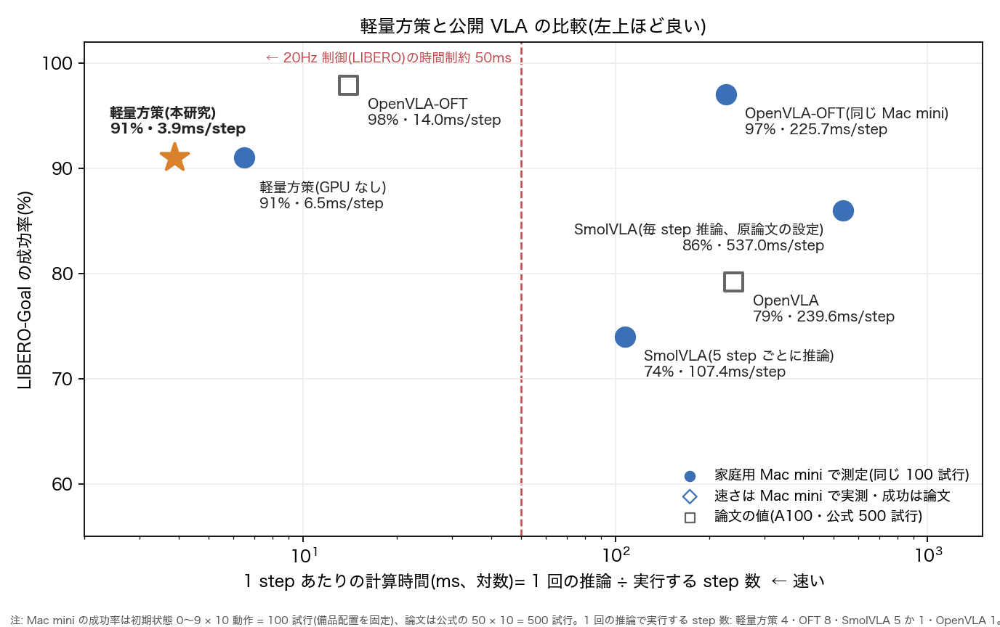
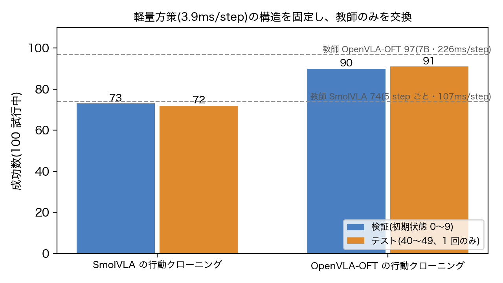
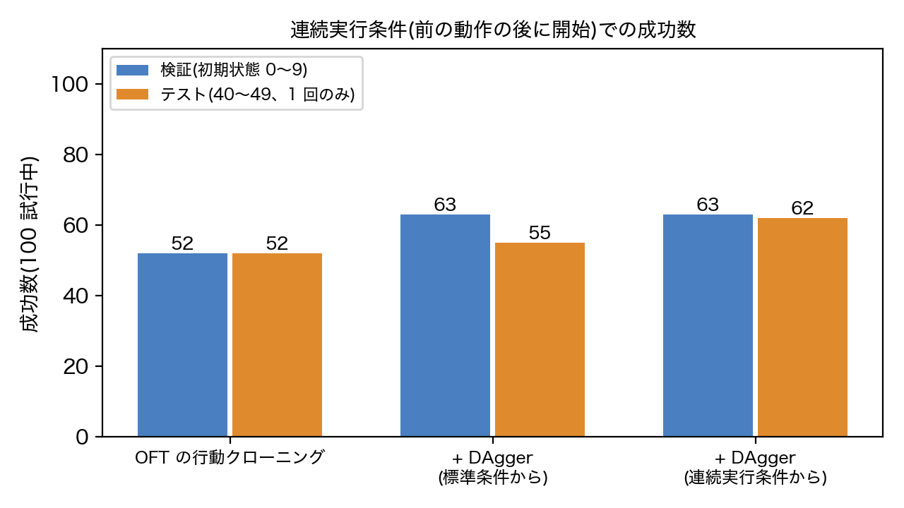
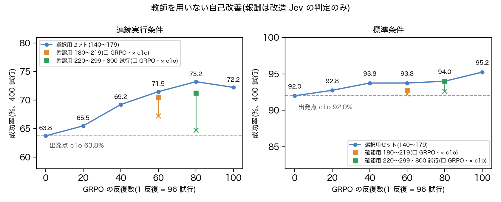
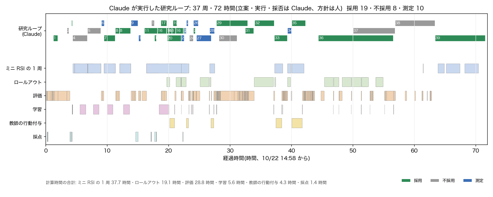

# エッジで動く AI ロボットを、家庭用パソコンで RSI

**ネットワークから切り離して動作し、Mac mini 1 台で自己改善する家事ロボット**(Physical AI 応用編1 最終課題、シミュレーション)

[報告書(全文、16 ページ)](docs/report_v2.pdf) | [概要版(3 ページ)](docs/report_short.pdf) | [学習済みモデル(Hugging Face)](https://huggingface.co/Harinezumi-RSI/edge-robot-rsi) | [動画(YouTube、3 分)](https://youtu.be/PFmPhbcUxFw)

[](https://youtu.be/PFmPhbcUxFw)

## 概要

本研究では、家庭用計算機 Mac mini(Apple M4 Pro、メモリ 24GB)1 台で動作し、音声で頼まれた台所の作業を行うロボットを構築した。さらに、同じ計算機の上で自己改善(Recursive Self-Improvement, RSI)させた。システムは公開モデルのみで構成し、外部への通信を遮断した環境で動作する(推論時の重みは計 約 5.3GB)。

RSI は 2 層で設計した。
- **内側の層**: ロボット自身の自己改善。ロールアウトし、状態判定器で自己採点し、方策を再学習する。
- **外側の層**: 研究のループ。方針を人が示し、仮説の立案・実験・採否をコーディングエージェント Claude が担った。



## 主な結果

比較はすべて同一試行の対応比較とし、両側の符号検定の p 値を付す。初期状態は学習 10〜39、検証 0〜9、テスト 40〜49 に分けた。教師を用いない自己改善では、公式と同じ手続きで生成した新規の初期状態(番号 100〜299)を選択用と確認用に分け、判定基準を事前に記録してから確認用を 1 回のみ評価した。

| 項目 | 条件 | 結果 |
|---|---|---|
| 達成済み目標の除外による計画 | 評価用 40 場面 | 計画の正答 21 → **34/40**、不要な動作 14 → **0**(p=0.0002) |
| 状態判定器(改造 Jev) | 10 目標の達成判定 | AUC **0.998**(ゼロショット 0.919)、画像 1 枚 **0.35 秒**(同 7.80 秒) |
| 軽量方策の計算時間 | Mac mini、1 step あたり | **3.9ms**(20Hz 制御の 50ms 以内)。SmolVLA 107〜537ms、OpenVLA-OFT 226ms |
| 教師方策の交換(方策の構造は同一) | テスト 100 試行 | SmolVLA の模倣 72 → OpenVLA-OFT の模倣 **91**(p=0.0003) |
| DAgger(前の動作で変化した場面から開始) | 検証 + テスト 200 試行 | 改善 37・悪化 16(p=0.0055)。テストで 52 → **62** |
| 摂動した開始姿勢からの自己改善(SmolVLA) | テスト、得意な 4 動作 | 14 → **26/40**(p=0.0005)。摂動なしは 36 → 36 |
| **教師を用いない自己改善(GRPO 系)** | 確認用 800 試行 | 変化した場面 64.8 → **71.3%**(p=4.9×10⁻⁶)、通常の場面 92.6 → 94.0% |
| 音声で 3 回続けて頼む通し評価 | テスト 10 セッション | **15/30**(検証 20/30)。失敗 15 のうち 11 が方策 |

### 計算時間と成功率

軽量方策は、家庭用計算機で 20Hz 制御の時間制約を満たす唯一の構成である。重い教師は学習時のみ用い、実行時は軽量方策のみを用いる。



| 教師の交換 | 前の動作で変化した場面での DAgger |
|---|---|
|  |  |

### 教師を用いない自己改善

報酬は改造 Jev の判定のみとし、教師もシミュレータの正解も用いない。言語モデルの強化学習の要素(GSPO の系列単位の重要度比、Dr. GRPO の正規化、DAPO の混在群サンプリングと非対称クリップ)と、初期方策への KL 正則化を組み合わせた。1 反復は 12 場面 × 8 試行で、100 反復(約 9,600 試行)を Mac mini 1 台で約 5 時間かけて実行した。

| 確認 | ヘッドの選択 | 確認用セット | 変化した場面 c1o → GRPO | 通常の場面 c1o → GRPO |
|---|---|---|---|---|
| 1 回目 | 検証 100 試行(63 → 72) | 100〜139 | 68.0 → 71.0%(p=0.18) | 94.3 → **89.5%(p=0.009、低下)** |
| 2 回目 | 選択用 400 試行、60 反復目 | 180〜219 | 67.3 → 70.5%(p=0.20) | 92.3 → 92.8% |
| 3 回目 | 選択用 400 試行、80 反復目 | 220〜299(800 試行) | 64.8 → **71.3%(p=4.9×10⁻⁶)** | 92.6 → 94.0%(p=0.20) |

事前に記録した基準(変化した場面で p < 0.05 かつ通常の場面が有意に低下しない)は、3 回目で満たした。1 回目と 2 回目は基準に届かなかったが、その結果もそのまま報告している。



### 他の LIBERO スイート(教師 SmolVLA、検証 100 試行)

| スイート | 教師 SmolVLA | 行動クローニング(l0) | + DAgger(d1) |
|---|---|---|---|
| Object | 92 | 66 | **87**(l0 → d1: p=0.0011) |
| Spatial | 70 | 58 | 63(p=0.58) |
| Long | 44 | 49 | 29(l0 → d1: p=0.0005、低下) |

### 研究ループ

外側のループは 37 周、約 72 時間動作した。内訳は採用 19、不採用 8、測定のみ 10 である。立案・実行・採否は Claude が担い、人は一部の周で方針を示した。全周の結果と判断は [`docs/rsi_runs.jsonl`](docs/rsi_runs.jsonl) に、仮説と経緯は [`docs/rsi_log.md`](docs/rsi_log.md) に記録した。



## システム構成

| 構成要素 | モデル(すべて公開モデル) | 役割 |
|---|---|---|
| 音声認識 | Qwen3-ASR 0.6B(4bit) | 台所の語彙をヒントとして与え、ヒントが書き起こしに混入した場合は再認識する |
| 計画器 | Qwen3.5-4B(MLX 4bit) | 8 個の例示と会話履歴から、動作番号の列(計画)を生成する |
| 状態判定器 | 改造 Jev(Qwen3.5-4B の第 8 層 + 目標ごとのロジスティック回帰) | 計画前に達成済みの目標を検出し、動作後に成否を確認する |
| 行動方策 | 軽量方策(DINOv2-small(凍結)+ 行動ヘッド 6MB、`models/lite/c1o.npz`) | 8 step のアクションチャンクを出力し、4 step を実行する |
| 音声合成 | Irodori-TTS v4.1 Small(8bit) | 応答を音声で出力する(声質は文章で指定) |
| 教師方策(学習時のみ) | OpenVLA-OFT(LIBERO-Goal の公開重み)、初期は SmolVLA | 学習データの行動を付与する |
| 環境 | LIBERO-Goal(robosuite / MuJoCo) | 同一場面で目標のみが異なる 10 動作を、1 つのシミュレーションで続けて実行する |

## 再現手順
```bash
# 行動方策と環境(Python 3.10)。LIBERO は Mac で作れない部品を外して入れる
python3.10 -m venv .venv && .venv/bin/pip install "lerobot[smolvla]==0.4.4" "scipy==1.14.1" \
  "robosuite==1.4.0" "bddl==1.0.1" "mujoco==3.7.0" "hydra-core>=1.2,<1.4" easydict einops matplotlib cloudpickle opencv-python future
.venv/bin/pip install --no-deps "hf-libero>=0.1.3,<0.2.0"
# 計画器・状態判定器・音声認識・音声合成(Python 3.11、MLX)
python3.11 -m venv .venv-mlx && .venv-mlx/bin/pip install mlx-vlm mlx-audio scikit-learn
source env.sh   # このディレクトリ専用の LIBERO 設定・モデル置き場(.libero/config.yaml は末尾)

# 1) 音声デモ(外部への通信を禁止したサンドボックス内で、計画器のサーバと行動方策を実行する)
zsh offline_demo.sh d01 models/lite/c1o.npz "コンロの火、つけておいてくれる？" "冷えてきたね、器をあたためておいてくれる？"

# 2) 通し評価(音声で 3 回続けて指示するセッション × 10)
.venv-mlx/bin/python kitchen/brain_server.py &
.venv/bin/python kitchen/e2e_session.py --hand models/lite/c1o.npz --inits 0-9 --tag dev

# 3) 軽量方策の評価(8 環境を並列、10 動作 × 初期状態 0〜9)
.venv/bin/python kitchen/lite_batch.py --skills 0 1 2 3 4 5 6 7 8 9 --inits 0-9 --head models/lite/c1o.npz --out outputs/x.jsonl
```

軽量方策の学習と自己改善(教師 OpenVLA-OFT を用いる。約 16GB):
```bash
# 教師の環境(Python 3.11)。動いた組み合わせ: torch 2.13.0・timm 0.9.10・tokenizers 0.19.1・accelerate 1.14.0・
# transformers は OpenVLA-OFT の改造版(双方向の注意。PyPI の 4.40.1 と版番号が同じで中身が違う、Moo Jin Kim による)・prismatic は openvla-oft から
# (手順を一から通しては確かめていない。置き場は env の PAI_OFT_PY・PAI_OFT_CODE で変えられる)
python3.11 -m venv .venv-oft && .venv-oft/bin/pip install torch "timm==0.9.10" "tokenizers==0.19.1" accelerate sentencepiece \
  "transformers @ git+https://github.com/moojink/transformers-openvla-oft.git"
git clone https://github.com/openvla-oft/openvla-oft vendor/openvla-oft   # prismatic を読むだけ(pip install はしない)
huggingface-cli download moojink/openvla-7b-oft-finetuned-libero-goal --local-dir models/oft_goal

# 教師のロールアウト 300 試行(初期状態 10〜39)→ 再描画して DINOv2-small 特徴を抽出 → 行動ヘッドの学習(約 10 秒)
.venv/bin/python kitchen/oft_session.py -- .venv/bin/python kitchen/fast_rollout.py --teacher oft --skills 0 1 2 3 4 5 6 7 8 9 \
  --inits 10-39 --n-envs 4 --record data/rsi/r0o/demos --record-all --kind practice --out outputs/rsi/r0o_practice.jsonl
.venv/bin/python kitchen/lite_data.py --demos data/rsi/r0o/demos --every 4 --backend dino --out data/lite/r0o_dino.npz
.venv/bin/python kitchen/lite_train.py --data data/lite/r0o_dino.npz --out models/lite/l0o.npz

# 自己改善の 1 周: ロールアウト → 改造 Jev で採点 → 教師が行動を付与(Jev が成功と判定した試行は間引く)→ 再学習 → 評価
.venv/bin/python kitchen/lite_rsi.py --tag d1o --mode dagger --teacher oft --dagger-sparse-ok --prev models/lite/l0o.npz --pool data/lite/r0o_dino.npz

# 教師を用いない自己改善(オンライン強化学習、報酬は改造 Jev のみ。計画器・状態判定器のサーバ brain_server.py を先に起動)
.venv/bin/python kitchen/fresh_inits.py --n 200          # 学習にも選択にも用いない新規の初期状態(番号 100〜299)
.venv/bin/python kitchen/lite_grpo.py --init models/lite/c1o.npz --ref models/lite/c1o.npz --tag g6 \
  --skills 0 1 2 3 4 5 6 7 8 9 --modes both --scenes 12 --group 8 --iters 100 --eval-every 20 --eval-normal --eval-inits 140-179 \
  --workers 3 --n-envs 6 --recycle 10 --lr 1e-5 --kl 2.0 --seq-ratio --no-std --mixed-only --curriculum --clip-high 0.28 \
  --hard-below 0.1 --reuse 3 --replay data/lite/r0o_dino.npz data/lite/d1o_dagger.npz data/lite/c1o_dagger.npz --replay-kl 4.0
.venv/bin/python kitchen/lite_grpo.py --eval-only --eval-normal --init models/lite/g6c_it20.npz --tag test3 --eval-inits 220-299  # 確認用セットでの評価(1 回のみ)
```


## 学習済みモデル(Hugging Face)

軽量方策、教師を用いない自己改善後の方策、改造 Jev の判定器、LIBERO 3 スイートの方策(合計 約 42MB、MIT)を、[Harinezumi-RSI/edge-robot-rsi](https://huggingface.co/Harinezumi-RSI/edge-robot-rsi) で公開している。各ファイルの内容と評価結果はモデルカードに記載した。

```bash
.venv/bin/python -c "from huggingface_hub import snapshot_download; snapshot_download('Harinezumi-RSI/edge-robot-rsi', local_dir='models/hf')"
.venv/bin/python kitchen/lite_batch.py --skills 0 1 2 3 4 5 6 7 8 9 --inits 0-9 --head models/hf/hand/g6c_it20.npz --out outputs/lite/hf_g6c/val.jsonl
```

## ファイル構成

| ファイル | 役割 |
|---|---|
| `kitchen/chain_env.py` | 目標を差し替えて続けて実行する環境、備品配置の乱数種による固定、腕の初期姿勢の摂動(ミニ RIS) |
| `kitchen/brain.py` / `brain_server.py` | 計画器(計画の生成と確認)/ 計画器・状態判定器・音声認識・音声合成の HTTP サーバ |
| `kitchen/jev2.py` / `judge_runs.py` | 改造 Jev(第 2 版)/ 試行の画像への達成確率の付与 |
| `kitchen/voice.py` | 音声認識(Qwen3-ASR)と音声合成(Irodori-TTS) |
| `kitchen/lite_*.py` | 軽量方策: 特徴抽出(`lite_feats`)、データ(`lite_data`)、学習(`lite_train`)、並列評価(`lite_batch`)、DAgger(`lite_dagger`)、自己改善の 1 周(`lite_rsi`)、ヘッドの選択(`lite_select`)、教師を用いないオンライン強化学習(`lite_grpo`)、小規模な再学習(`lite_finetune`) |
| `kitchen/fresh_inits.py` | 公式と同じ手続きによる新規初期状態の生成(番号 100 以降。lerobot は 50 以降の番号を 0〜49 に折り返すため) |
| `kitchen/oft_server.py` / `oft_session.py` / `oft_teacher.py` | 教師 OpenVLA-OFT を Mac の GPU で実行するサーバ / 使用中のみ起動 / 方策からの呼び出し |
| `kitchen/fast_rollout.py` / `vla.py` | N 環境の並列実行器(教師のロールアウトと評価)/ SmolVLA のラッパ |
| `kitchen/suite_loop.py` | 他の LIBERO スイートでの行動クローニングと DAgger |
| `kitchen/demo.py` / `e2e_session.py` | 音声デモ / 通し評価 |
| `kitchen/scene_eval.py` | 達成済み目標の除外の評価 |
| `kitchen/make_bench.py` / `make_figures.py` / `make_timeline.py` / `make_video.py` | ベンチマーク表・図・研究ループの経過・動画の生成 |
| `kitchen/runlog.py` | 研究ループの時間と試行数の記録 |
| `docs/` | 報告書、実験記録(`rsi_log.md`・`rsi_runs.jsonl`)、ベンチマーク(`bench.md`)、関連研究(`related_work.md`)、図 |

## ライセンスと利用したモデル

本リポジトリのコード・記録・図は MIT License(`LICENSE`)である。以下のモデルとライブラリはそれぞれのライセンスに従い、重みは本リポジトリに含めない(各配布元から取得する)。

Qwen3.5-4B / 0.8B(Apache-2.0)、Qwen3-ASR(Apache-2.0)、Irodori-TTS(MIT、なりすまし等を禁じる利用上の制限あり)、DINOv2(Apache-2.0)、SmolVLA(Apache-2.0)、OpenVLA-OFT(MIT、言語モデル部分は Llama 2 Community License)、改造版 transformers(Apache-2.0)、LIBERO(MIT)、LeRobot(Apache-2.0)、robosuite(MIT)、MuJoCo(Apache-2.0)、MLX / mlx-vlm / mlx-audio(MIT)。

**Claude の利用について.** Claude(Anthropic)は、外側の研究ループの実行者として、コードの作成、実験の実行と結果の読解に用いた。また、報告書と動画の下書きの作成にも用いた。本課題で学習したのは、ロボットの行動ヘッド(6MB)と、画像から目標の達成を判定するヘッド(改造 Jev)である。これらは Claude のような汎用の AI サービスと競合するものではない。いずれも正解は教師モデル(OpenVLA-OFT・SmolVLA)の行動とシミュレータの目標判定から作成しており、Claude の出力は学習データに含めていない。Claude が作成した発話文は、評価と、不採用とした計画確認ヘッドの試作 `kitchen/plan_jev.py` にのみ用いた。

## 付録: `.libero/config.yaml`

`env.sh` は `LIBERO_CONFIG_PATH` を本ディレクトリの `.libero` に設定する。設定ファイルは、venv 内の LIBERO を指す 5 項目(`assets / bddl_files / benchmark_root / datasets / init_states`)からなり、他のプロジェクトの `~/.libero` は参照しない。場面の素材(406MB、4 種の場面を含む)は、初回の実行時に `~/.cache/libero/assets` に取得される。
