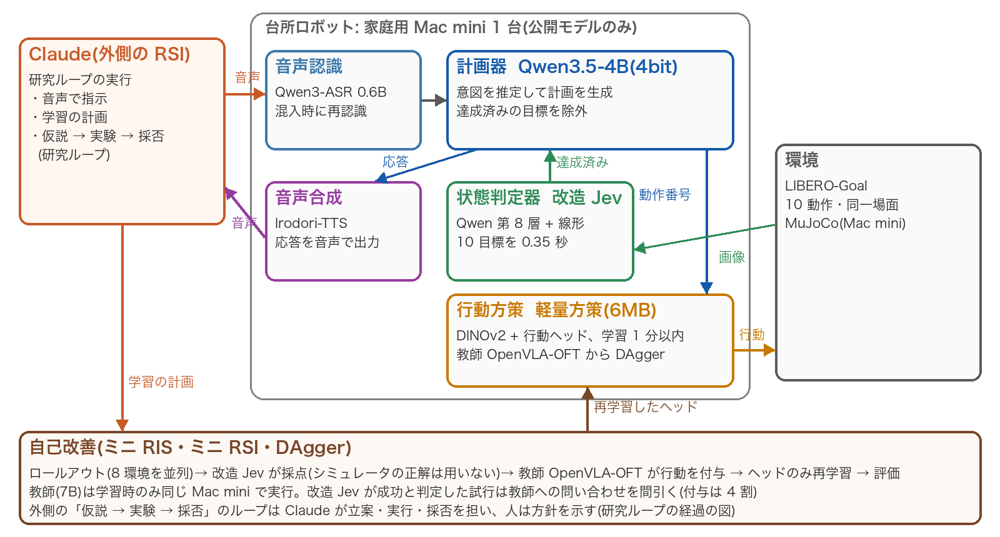
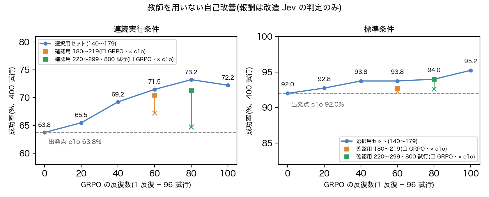

> 本資料は概要版である。手法・実験設定・全結果・考察・参考文献を含む全文(16 ページ)は、提出した GitHub リポジトリの `docs/report_v2.pdf` にある。

## 概要

家庭用計算機 Mac mini(Apple M4 Pro、メモリ 24GB)1 台で動作し、音声で頼まれた台所の作業を行うロボットを構築した。さらに、そのロボットを同じ計算機の上で自己改善(Recursive Self-Improvement, RSI)させた。構成は公開モデルのみで、外部への通信を遮断した環境で動作する(シミュレーション: LIBERO-Goal)。RSI は 2 層で設計した。内側の層は、ロボットが練習し、自らの目で採点し、方策を学び直すループである。外側の層は、仮説・実験・採否からなる研究のループである。外側のループは、方針を人が示し、立案・実行・採否をコーディングエージェント Claude が担った。

## 目的

家庭のロボットには、(1) 遠回しな依頼から意図を察すること、(2) 動作の結果を自ら確かめること、(3) 練習で上達すること、(4) 家庭内の情報を外に出さないことが求められる。本課題では、これらを大きな GPU なしに、一般家庭の計算機 1 台で実現することを目指した。

## 工夫した点

**創造性**

- **二層の RSI**: ロボットの自己改善(内側)と研究の自己改善(外側)を、同じ Mac mini の上で入れ子に回した。外側のループは手法だけでなく、評価手続きの欠陥(評価器の再現性、少ない試行数での選択の上振れ)も見つけて直した。
- **見てから察する**: 依頼を受けたら場面を撮り、すでに達成されている目標を計画から除外する。これにより「冷えてきたね、器をあたためておいて」に対して、「もうコンロの火がついているので、黒い器をコンロの上に置きますね」と応じられる。

**技術力**

- **改造 Jev(状態判定器)**: 小さな視覚言語モデル(Qwen3.5-4B、4bit)の第 8 層で計算を打ち切り、目標ごとの線形判定器を付けた。画像 1 枚で 10 個の目標を 0.35 秒で判定でき、問いかけ方式より 22 倍速い。正解ラベルはシミュレータから自動で作り、人手のラベルは 0 枚である。
- **軽量方策**: 凍結した画像特徴(DINOv2-small)に 6MB の行動ヘッドだけを学習する。学習は 1 分以内で、推論は 1 step あたり 3.9ms である。重い教師(OpenVLA-OFT 7B)は学習時だけ同じ計算機で動かし、実行時は軽量方策だけを使う。
- **教師を用いない自己改善**: 大規模言語モデルの強化学習の手法(GRPO・GSPO・Dr. GRPO・DAPO)を、ロボットの方策に移した。報酬は改造 Jev の判定のみとした。
- **水増しを防ぐ評価**: 公式と同じ手続きで新しい初期状態を作り、選択用と確認用に分けた。判定基準は事前に記録し、比較はすべて同一試行の対応比較(符号検定)で行った。

**実用性**

- 推論時の重みは約 5.3GB で、ネットワークなしで動作する。家の中の映像や会話が外に出ない。
- 20Hz 制御(50ms/step)の時間制約を、家庭用計算機で満たすのは軽量方策のみである(SmolVLA は 107〜537ms/step、OpenVLA-OFT は 226ms/step)。
- 自己改善の 1 周(練習・採点・教師の付与・学び直し・評価)も同じ計算機で回り、外部の GPU を必要としない。

## 主な結果

| 項目 | 結果 |
|---|---|
| 達成済み目標の除外(評価用 40 場面) | 計画の正答 21 → **34/40**、不要な動作 14 → **0**(p=0.0002) |
| 教師の交換(軽量方策の構造は同じ、テスト 100 試行) | 72 → **91%**(p=0.0003) |
| 摂動した開始姿勢からの自己改善(テスト、得意な 4 動作) | 14 → **26/40**(p=0.0005) |
| 前の作業で変化した場面からの開始(DAgger、検証とテスト 200 試行) | 改善 37・悪化 16(p=0.0055) |
| **教師を用いない自己改善**(事前登録した確認用 800 試行) | 変化した場面 64.8 → **71.3%**(p=4.9×10⁻⁶)、通常の場面 92.6 → 94.0% |
| 音声で 3 回続けて頼む通し評価(テスト 10 セッション) | **15/30**(失敗 15 のうち 11 が方策) |
| 他の LIBERO スイート(Object、検証 100 試行) | 行動クローニング 66 → DAgger **87**(p=0.0011) |

外側の研究ループは 37 周・約 72 時間動作した(採用 19、不採用 8、測定のみ 10)。教師を用いない自己改善は、事前登録した 3 回の確認のうち 1・2 回目では基準に届かなかった。3 回目で基準を満たしており、届かなかった 2 回分もそのまま報告している。

## 限界

- 評価はシミュレーションのみである。
- 続けて頼むと、前の依頼で変化した場面で方策が弱い。
- 教師の成功率が低い長期課題(LIBERO-Long)では、DAgger が逆効果だった。

## 詳細と再現

- **GitHub リポジトリ**(提出フォームに記載): コード一式、全文レポート `docs/report_v2.pdf`、実験記録 `docs/rsi_log.md`、関連研究、図。
- **Hugging Face**: 学習済みモデル一式(取得手順は README)。
- **利用した公開モデル**: Qwen3.5、Qwen3-ASR、Irodori-TTS、DINOv2、SmolVLA、OpenVLA-OFT、LIBERO、LeRobot。各ライセンスは全文の 9 章に記載した。
- **Claude の利用**: Claude(Anthropic)は外側の研究ループの実行者として用いた。学習したモデルは、ロボットの行動ヘッドと状態判定器であり、Claude の出力は学習データに含めていない。
