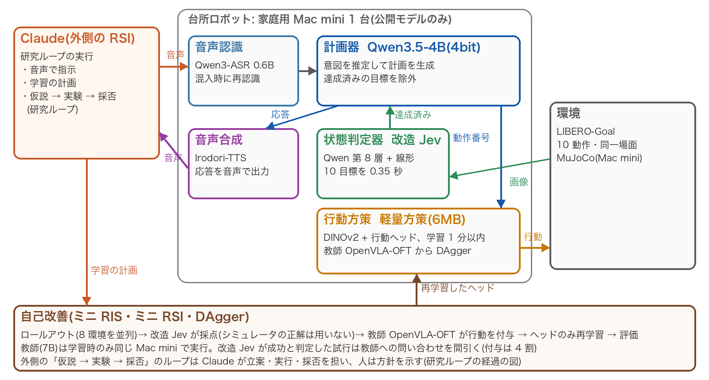
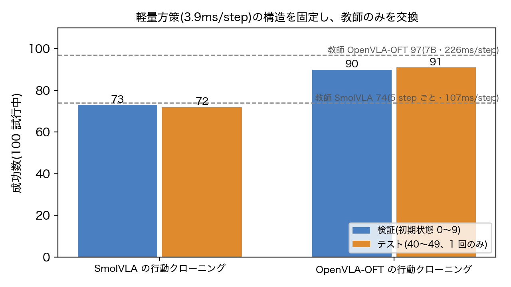
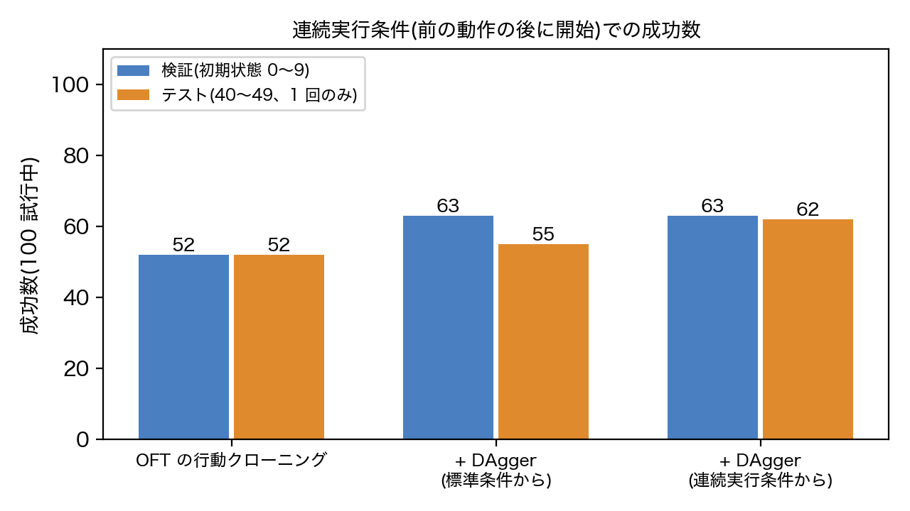
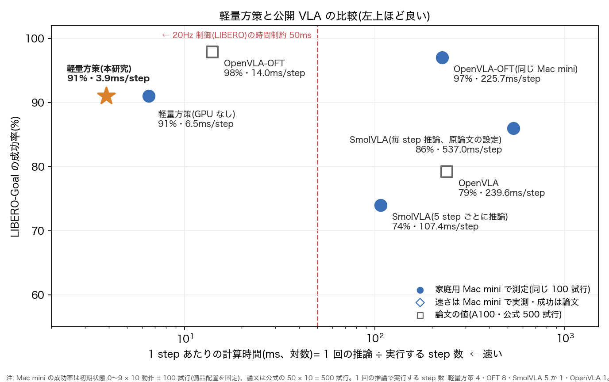
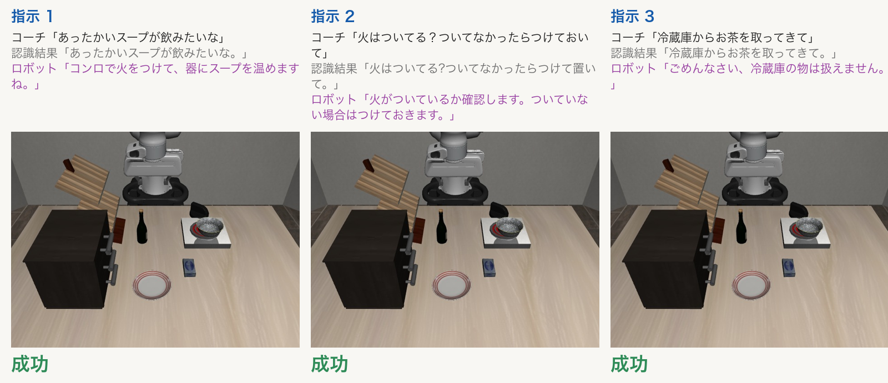
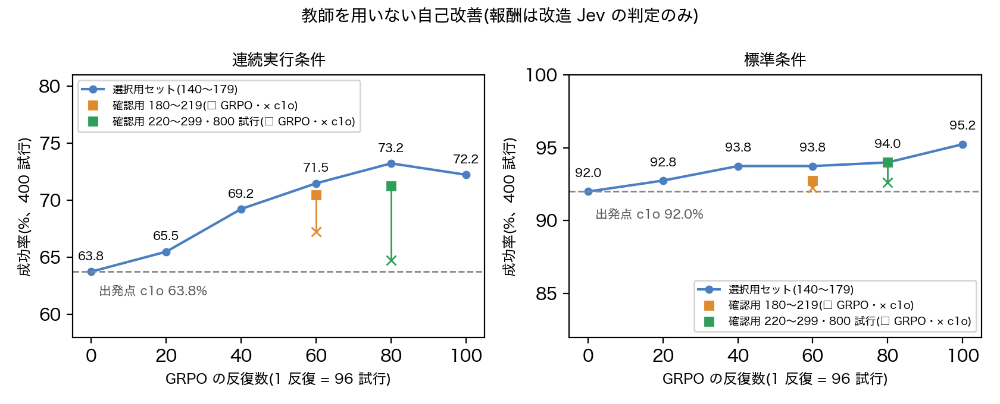
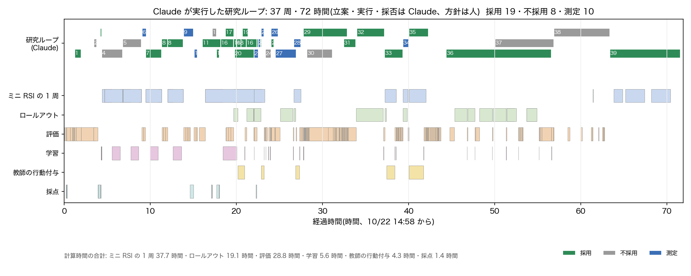

## 要旨

本研究では、家庭用計算機 Mac mini(Apple M4 Pro、メモリ 24GB)1 台で動作する、音声指示に基づく台所作業ロボットを構築し、同一の計算機上で自己改善(Recursive Self-Improvement, RSI)のループを実行した。システムは公開モデルのみで構成し、外部への通信を遮断した環境で動作する(推論時の重みは計 約 5.3GB)。主な結果は次の 4 点である。(1) 視覚言語モデルの中間層に線形判定器を付けた状態判定器(改造 Jev)で達成済みの目標を検出し、計画から除外することで、40 場面の評価で計画の正答を 21 から 34 に改善し、不要な動作を 14 から 0 に減らした(p=0.0002)。(2) 凍結した DINOv2-small 特徴に 6MB の行動ヘッドのみを学習する軽量方策は、1 step あたり 3.9ms で動作し、20Hz 制御の時間制約を満たす唯一の構成であった。教師方策を SmolVLA から OpenVLA-OFT に替えることで、テストセットの成功率は 72% から 91% に向上した(p=0.0003)。(3) 改造 Jev の判定のみを報酬とする教師なしのオンライン強化学習(GRPO 系)により、事前に登録した確認用セット 800 試行で、連続実行条件の成功率が 64.8% から 71.3% に向上した(p=4.9×10⁻⁶)。標準条件の成功率は低下しなかった(92.6% → 94.0%)。(4) RSI は 2 層で設計した。内側はロボット自身の自己改善、外側は仮説・実験・採否からなる研究のループである。外側のループは同じ計算機上のコーディングエージェント Claude に実行させ、人は目的・制約・方向づけの設計とレビューを担った。自動化による結果の水増しを防ぐため、評価データの分離と判定基準の事前記録をループに組み込んだ。外側のループは 37 周、約 72 時間動作した。実験の実行と採否は Claude が担い、人は一部の周で方針を示した。その過程で、評価手続き自体の欠陥も見つけて改善した。

## 1. はじめに

家庭で用いるロボットには、少なくとも次の 4 つの性質が求められる。(1) 間接的な表現による依頼から意図を推定すること、(2) 動作の結果を自ら確認すること、(3) 試行を通じて上達すること、(4) 家庭内の情報を外部に送信せずに動作すること。本研究は、これらを大規模な GPU を用いず、一般家庭で入手可能な計算機 1 台で実現することを目的とする。

RSI(再帰的自己改善)は、改善を行う過程そのものが改善の対象となる構造を指す。家庭用計算機でロボットの自己改善を回すとき、律速となるのは計算資源よりも、仮説を立て、実験を設計・実行し、結果から採否を判断する人の時間である。そこで本研究では、研究のループそのものを RSI の外側の層として意図的に設計し、その実行をコーディングエージェントに委ねた。ロボットが練習と自己採点で方策を改善する内側のループと、エージェントが実験と採否で手法と評価手続きを改善する外側のループが、同じ Mac mini 1 台の上で入れ子に動く。これが題目の「家庭用パソコンで RSI」の意味である。

本報告の貢献は以下である。

- 音声認識・計画・状態判定・行動生成・音声合成のすべてを公開モデルで構成し、ネットワークから切り離して動作する台所ロボットを構築した(3 章)。
- 小規模な視覚言語モデルの中間層を用いた高速な状態判定器(改造 Jev)を作成し、計画と自己評価の双方に用いた(4.1〜4.2 節)。
- 凍結した視覚特徴と小さな行動ヘッドからなる軽量方策を設計した。性能の上限が方策の構造ではなく教師方策によって決まることを示した(4.3 節)。
- 教師方策を用いる自己改善(DAgger 型)と、教師を用いないオンライン強化学習の双方を同一計算機上で実行し、事前登録した評価手続きで効果を確認した(4.4〜4.5 節、6.8 節)。
- 研究ループを外側の RSI として設計した。人とエージェントの役割を分け、自動化された研究が結果を水増しできない評価の仕組みを組み込んだうえで、37 周を実行した(4.6 節、6.11 節)。

## 2. 関連研究

**成功判定と状態判定.** 言語モデルの選択肢確率を判定に用いる手法 [1]、成功判定器の出力を計画に戻す Inner Monologue [2]、VLM を成功判定器として微調整する SuccessVQA [3] がある。本研究に最も近いのは、VLM の中間層に軽量な分類ヘッドを付けて失敗を検出する I-FailSense [4] である。本研究の改造 Jev は、量子化した 4B モデルの浅い層で計算を打ち切ること、10 個の目標を 1 回の順伝播で判定すること、正解ラベルをシミュレータの述語から自動で付与することの 3 点で異なる。出力の形式(確率付きの型付き判定)は TypeSafe の Jev [5] を参考にした。

**軽量方策と教師からの学習.** 凍結した視覚表現に小さな MLP を付けて模倣学習する評価の型は R3M [6] に従う。教師方策には OpenVLA-OFT [7] と SmolVLA [8] を、視覚特徴には DINOv2 [9] を用いた。学習者が到達した状態に教師が行動を付与する DAgger [10] を、方策から方策への蒸留として用いた。

**言語モデルの強化学習.** 教師を用いない自己改善には、言語モデルの強化学習で提案された GRPO [11] とその改良を用いた。具体的には、系列単位の重要度比を用いる GSPO [12]、優位度を標準偏差で正規化しない Dr. GRPO [13]、成功と失敗が混在する群のみを用いるサンプリングと非対称クリップ(DAPO [14])、学習分布の外の性能を保つ正則化(PPO-ptx [15] と同じ狙い)である。ロボット方策への GRPO の適用には SimpleVLA-RL [16] がある。成功した試行のみで学び直す ReST [17] とも比較した。

評価環境には LIBERO [18] を用いた。関連研究の詳細は `docs/related_work.md` にまとめた。

## 3. システム構成

本システムは 5 つの構成要素からなる(図「システム構成」)。

- **音声認識**: Qwen3-ASR 0.6B(4bit)。台所の語彙をヒントとして与え、ヒントの文字列が書き起こしに混入した場合は認識をやり直す。
- **計画器**: Qwen3.5-4B(MLX、4bit)。8 個の例示と会話履歴を与え、動作番号の列(計画)を生成する。
- **状態判定器(改造 Jev)**: 計画器と同じ 4B モデルの第 8 層の状態に、目標ごとの線形判定器を付けたもの。画像 1 枚あたり 0.35 秒で 10 個の目標の達成確率を出力する。計画前の状態確認(4.1 節)と、動作後の成否確認に用いる。
- **行動方策**: 軽量方策(DINOv2-small と 6MB の行動ヘッド)。8 step のアクションチャンクを出力し、うち 4 step を実行する。デモと通し評価のシステムで用いた方策は単一のヘッド c1o である(教師を用いない自己改善で得たヘッドは 6.8 節で別に評価した)。動作ごとにヘッドを切り替える方式も試したが、検証セットの通し評価で c1o 単独を上回らなかった。
  - 教師方策 OpenVLA-OFT は、LIBERO-Goal 向けの公開重みを同じ Mac mini の GPU で実行する。推論 1 回に 1.8 秒かかるため、学習時のみ用いる。初期の教師は SmolVLA(公開重み)である。
- **音声合成**: Irodori-TTS v4.1(日本語、声質は文章で指定)。

作業環境は LIBERO-Goal の 10 動作である。これらは同一の場面で目標のみが異なり、1 つのシミュレーション内で続けて実行する。動作と動作の間では、腕を定位置(ホーム)へ戻す。

## 4. 手法

### 4.1 達成済み目標の除外による計画

計画器に場面の様子を言語で与える方式は有効でなかった。計画器は、記述された達成済みの目標をかえって計画に加え、正答は 40 場面中 25 にとどまった。LIBERO-Goal では動作と目標の述語が 1 対 1 に対応する。そこで計画器には利用者の望む目標のみを推定させ、改造 Jev が達成済みと判定した目標を計画から除外した。応答は「もうコンロの火がついているので、黒い器をコンロの上に置きますね」のように、除外の理由を含む。

### 4.2 改造 Jev

Qwen3.5-4B の第 8 層(全 32 層)の状態に、目標ごとのロジスティック回帰を学習した。入力は、第 1 版では最後のトークンの状態、第 2 版では画像トークンの平均である。正解ラベルはシミュレータの述語から自動で付与し、人手のラベルは用いない。第 8 層で順伝播を打ち切り、語彙への射影も省略することで高速化した。

第 2 版では学習画像を 300 枚から 840 枚に増やし、判定器の構成を「実行しようとした目標」に対する交差検証で選び直した。その結果、自己改善の採点で誤って棄却される真の成功の割合は 12% から 2% に減少した。

### 4.3 軽量方策

**視覚特徴の比較.** 同一のデータと行動ヘッドで、視覚特徴の取り出し元を比較した(100 試行中の成功数)。Qwen3.5-0.8B の中間層は 46、同モデルの視覚エンコーダのみでは 47、DINOv2-small は 57 であった。言語モデルを通した特徴は行動の質を改善しなかった。そこで言語の解釈は計画器が担い、方策は視覚特徴のみを用いる構成とした。

**教師方策の交換.** SmolVLA(5 step ごとに推論、成功率 74%)を教師とした方策は、データの修正や DAgger を行っても 72〜77 の範囲にとどまった。教師を OpenVLA-OFT(同一計算機で 97%)に替え、教師のロールアウト 300 試行(成功 290)を行動クローニングしただけで 90 に達した。同じ 100 試行で SmolVLA を模倣した方策の 73 と比べた対応比較は 23 勝 6 敗(p=0.0023)である。成功までの step 数も教師とほぼ同じであった(中央値 91.5 vs 92)。残る弱点は「チーズを器に入れる」(5/10)である。

**DAgger.** 学習者の方策が自ら到達した状態に、教師が以降 8 step の行動を付与して学習データに加える。

- 標準条件(初期状態から開始)では、どちらの教師でも 1 周の効果は誤差の範囲であった(SmolVLA 73 → 77、p=0.54。OFT 90 → 83、p=0.14)。効果が現れたのは、前の動作によって変化した状態から開始する条件である(4.4 節)。
- 同一のデータでも学習の乱数種のみで成功数は 150〜187/300 と変動し、特定の動作が丸ごと成功・失敗の間で入れ替わる。そのため学習 1 回どうしの比較は行わず、複数のヘッドを作成して比べた。比較には、検証用の初期状態で摂動なし 1 回と小さな摂動(σ=0.02 rad、乱数種違い)2 回の計 300 試行を用いた。
- OFT から学習したヘッドは 202〜233/300 で、SmolVLA から学習した 12 個(150〜197)をすべて上回った。動作ごとに最良のヘッドを選ぶ方式(248/300、選択に用いた集合での値のため楽観的)は、検証セットの通し評価で c1o 単独と同等であった(18・17 vs 20/30)。そのため単一ヘッドを採用した。

**アクションチャンクの実行.** 軽量方策を毎 step 再推論すると、成功は 77 から 62 に低下した(p=0.0015)。低下は引き出しの 2 動作に集中しており、取っ手の手前で動作が定まらず時間切れとなる。4 step を確定的に実行することが、この迷いを抜ける仕組みとして働いていた。教師の SmolVLA では逆に、毎 step 推論で 74 から 86 に向上した(p=0.023)。

**計算効率.** 画像特徴の抽出は 1 回のみとし、行動ヘッドは numpy で計算する。8 環境の一括推論は 81ms である。GPU を用いない場合は 1 環境で 25.9ms(CPU 4 スレッド)である。

### 4.4 教師を用いる自己改善(ミニ RIS・ミニ RSI)

- **摂動(ミニ RIS)**: 腕の 7 関節に N(0, 0.1 rad) の摂動を加える(手先で約 10cm に相当)。
- **自己改善(ミニ RSI)**: 8 環境でのロールアウト → 改造 Jev による採点(シミュレータの正解は用いない)→ 採用した試行のみでの再学習、を 1 周とする。摂動した姿勢から「手続き的にホームへ戻す → 方策が成功する」をつないだ試行を学習させ、立て直しを方策自体に獲得させた。
- **教師への問い合わせの削減**: 教師 OFT への問い合わせは 1 状態あたり約 1.9 秒かかり、1 周の律速となる。改造 Jev が成功と判定した試行(確率 0.8 以上)では 32 step おきにのみ教師の行動を付与した。これにより付与対象は 4,625 状態から 1,832 状態に減り、1 周あたり約 1.5 時間を短縮した。
- **連続実行条件**: 指示を続けて与えると、方策は前の動作によって変化した状態から動作を開始する。別の動作を終えた後の状態から開始すると成功は 171/300 で、4 動作が大きく低下した。内訳は、器をコンロに 2/30、引き出し(上)と器 4/30、チーズ 0/30、ワインをラックに 3/30 である。この状態に教師の行動を付与して再学習したヘッドが c1o である。
- **連続実行条件への頑健性の由来**: 教師を SmolVLA から OFT に替えると、標準条件は 73 から 90 に向上した。一方、連続実行条件(別の動作を実行してホームへ戻した後に開始)は 50 から 52 で向上しなかった。教師の行動クローニングだけでは、教師が通過した状態(常に初期状態から開始)しか学習されないためである。DAgger では、標準条件からの 1 周(d1o)でも連続実行条件からの 1 周(c1o)でも 52 から 63/100 に向上した(検証セット、d1o p=0.0074、c1o p=0.035、d1o と c1o の対応比較は 9 勝 9 敗)。
  - 以上から、連続実行条件そのもので学習することが必須とは言えない。c1o が d1o を上回った点は、標準条件と小さな摂動の 300 試行(212 → 233、p=0.017)と、前の動作の成功(82 → 95/100)である。
  - テストセット(初期状態 40〜49)では c1o 62、d1o 55、l0o 52 であった(c1o vs l0o は p=0.099)。検証セットと合わせた 200 試行では、c1o vs l0o 37 勝 16 敗(p=0.0055)、d1o vs l0o 25 勝 11 敗(p=0.029)、c1o vs d1o 21 勝 14 敗(p=0.31)である。

### 4.5 教師を用いない自己改善(オンライン強化学習)

報酬には改造 Jev の判定のみを用い、教師方策もシミュレータの正解も用いない。ただし試行の打ち切りは、他の評価と同様に環境の目標判定による。実装は `kitchen/lite_grpo.py` である。

1 反復では、12 場面 × 8 試行を 3 プロセスで並列に実行し、改造 Jev の採点を群内で比較して行動ヘッド(6MB)を更新する。これを 100 反復(約 9,600 試行、Mac mini 1 台で約 5 時間)行った。探索には、アクションチャンク単位のガウス雑音 N(0, σ) を用いた(グリッパには加えない)。報酬は次式である。

報酬 = 目標の達成確率 + 0.3 × 速さ − 0.5 × 他の目標の破壊 − 0.1 × 動作のがたつき

言語モデルの強化学習から導入した要素と、本研究での効果を表に示す。

| 要素 | 出典 | 本研究での効果 |
|---|---|---|
| 重要度比とクリップを試行(系列)単位で計算 | GSPO [12] | チャンク単位の比は σ が小さいと振れ、クリップで 4〜6 割の試行を捨てていた → 0.03〜0.2 に低下(試行を再利用しない構成。再利用する採用構成では 0.44〜0.76 に戻っており、未解決) |
| 群内の優位度を標準偏差で割らない | Dr. GRPO [13] | ほぼ同じ結果の群の小さな差を拡大しない |
| 成功と失敗が混在する群のみを使用 | DAPO [14] | 全成功・全失敗の群による雑音を除く |
| 成功率が五分に近い場面を優先して抽出(重み p(1−p)+0.05) | 本研究 | 学習信号の得られる場面に試行を集める |
| 上側クリップを広く設定(0.28) | DAPO [14]、SimpleVLA-RL [16] | |
| 初期方策の学習データ(全動作の場面)で初期方策への KL 正則化 | PPO-ptx [15] と同じ狙い(学習分布の外の性能を保つ) | 学習場面のみの正則化では、学習していない「火をつける」が 9 → 5 に低下 → 低下が解消 |
| 直近 3 反復の試行を重要度比とクリップで補正して再利用 | PPO [19] の同一データでの複数回更新と同じ考え方 | ロールアウトは 1 反復 約 2 分、更新は約 4 秒であり、試行の効率が律速 |
| 標準条件の場面も学習に含める | — | 確認用セットで標準条件 −5 点 → ±0 |

比較対象として、同一場面を K 回試行し、改造 Jev が成功と判定した試行を群の成功率が低いほど重く再学習する一括型の方式も試した(GRPO の群内優位度と ReST [17] の選別を組み合わせた形。1 周目 x1o・2 周目 x2o)。

### 4.6 二層の RSI と研究ループの設計

外側のループは、次の役割分担で設計した。

| 担い手 | 役割 |
|---|---|
| 人(著者) | 目的と課題の設定、制約の設定(外部通信なし・Mac mini 1 台・公開モデルのみ・データを削除しない)、研究の方向づけ(例: 教師を用いない自己改善には言語モデルの強化学習の最新手法を参照し、報酬を作り込む)、結果のレビューと公開範囲の判断 |
| Claude(外側のループ) | 仮説の立案、実験の実装と実行、結果の読解、採否の判断と記録、次の仮説への反映 |
| ロボット(内側のループ) | ロールアウト、改造 Jev による自己採点、方策の再学習 |

自動化された研究ループは、都合の良い結果を選ぶことで成果を水増しする危険を持つ。これを防ぐため、次の仕組みをループに組み込んだ。

- **評価データの分離**: 学習・検証・テストの初期状態を分け、テストセットは各モデルにつき 1 回のみ評価した(5 章)。教師を用いない自己改善では、選択用セットと確認用セットをさらに分けた。
- **事前登録**: 確認用セットを用いる前に、ヘッドの選び方と判定基準を記録した(`docs/rsi_log.md`)。基準に届かなかった 1 回目と 2 回目の結果も、そのまま報告する(6.8 節)。
- **報酬と正解の分離**: 自己改善の報酬には改造 Jev の判定のみを用い、シミュレータの正解は評価にのみ用いた。
- **統計的な採否**: 採否は同一試行の対応比較と符号検定で判断した。
- **全記録**: 不採用と測定のみの周も含め、全周の結果と判断を `docs/rsi_runs.jsonl` に、仮説と経緯を `docs/rsi_log.md` に記録した。

## 5. 実験設定

- **初期状態の分割**: LIBERO の初期状態(1 動作 50 通り)を、学習 10〜39、検証 0〜9、テスト 40〜49 に分けた。テストセットは各モデルにつき 1 回のみ評価した。ただし最初のテスト(SmolVLA 期の方策と通し評価)の後も開発を続け、第 2 版の方策の比較で再び用いたため、テストセットを用いた時期は 2 回ある。最終方策 c1o の選択規則は、検証セットの通し評価の結果を見る前に記録した。
- **新規初期状態**: 4.5 節のオンライン強化学習では、公式の初期状態をすでに使い切っていた。そこで公式と同じ乱数配置(腕関節の 0.02 rad の摂動を含む)で新たな初期状態を生成した(`kitchen/fresh_inits.py`、番号 100 以降)。1 組は 1 動作 40 通り × 10 動作 = 400 試行である(3 回目の確認用 220〜299 のみ 80 通り・800 試行)。選択用セット(140〜179)と、確認用セット 3 組(100〜139、180〜219、220〜299)に分けた。確認用セットは、ヘッドの選び方と判定基準を事前に記録(事前登録)したうえで、各組 1 回のみ使用した。
- **評価条件**: 標準条件は初期状態から目標の動作を実行する。連続実行条件は、目標の動作の前に別の動作を実行してホームへ戻した後に開始する。
- **発話データ**: 調整用 30 文、最終評価用 30 文、達成済み目標の除外の評価用(調整用 12・評価用 12)、通し評価のセッション 10 × 3 文。いずれも新たに作成し、調整に用いた文と重複しない。
- **統計**: 比較はすべて同一試行の対応比較とし、符号検定の p 値を付す。環境の備品配置は試行ごとの乱数種で固定した(6.10 節)。
- 数値の出典は `docs/rsi_log.md` および `docs/rsi_runs.jsonl` である。

## 6. 結果

### 6.1 達成済み目標の除外(評価用 40 場面、調整後に変更せず 1 回のみ評価)

| 方式 | 正答 | 一部が達成済みの場面 | 不要な動作 |
|---|---|---|---|
| 場面を用いない | 21/40 | 1/16 | 14 |
| 場面を言語で記述して与える | 25/40 | 4/16 | 11 |
| **達成済み目標の除外(改造 Jev)** | **34/40** | **14/16** | **0** |
| 達成済み目標の除外(真の状態) | 34/40 | 14/16 | 0 |

除外方式のみが正答した場面は 13、場面を用いない方式のみが正答した場面は 0 であった(p=0.0002)。改造 Jev の判定は 40 場面すべてで真の状態と一致した。残る 6 場面の誤りは、計画器による利用者の意図の推定誤りである(例:「器を一番上の引き出しの中へ」を棚の上と解釈)。

### 6.2 改造 Jev

| 方式 | 判定精度 | 1 枚の処理時間(10 目標) |
|---|---|---|
| ゼロショット(10 問の問いかけ、OpenJev 型) | AUC 0.919(全目標) | 7.80 秒 |
| 改造 Jev 第 1 版(画像 300 枚) | AUC 0.998(全目標)、実行しようとした目標 0.974 | 0.35 秒 |
| **改造 Jev 第 2 版(画像 840 枚、構成を交差検証で選択)** | 実行しようとした目標 **0.992** | 0.34 秒 |

第 1 版のテスト(画像 160 枚)では AUC 0.997 であった(ゼロショットは 0.988)。自己改善の採点で重要なのは「実行しようとした目標」の判定である。閾値 0.8 で誤って棄却される真の成功は 12% から 2% に減少した。軽量方策の DAgger では、改造 Jev が成功と判定した 278 試行のうち 264 が真の成功であった(適合率 95%)。

### 6.3 教師を用いる自己改善

**初期方策(SmolVLA)に対するミニ RIS・RSI**(腕の 7 関節に N(0, 0.1 rad) の摂動、手続き的な復帰なし)

| 条件 | 元の方策 | 自己改善後 |
|---|---|---|
| 摂動あり・得意な 4 動作(検証 40) | 13 | 25(p=0.0075) |
| 摂動あり・得意な 4 動作(**テスト** 40) | 14 | **26**(p=0.0005) |
| 摂動なし(テスト 40) | 36 | 36 |
| 摂動あり・全 10 動作(検証 100) | 22 | 53(p=3×10⁻⁷) |

「自己改善後」の値は、検証の 4 動作が 1 周目、テストが 2 周目(検証では 26/40、p=0.0010)、全 10 動作が全動作で学習した版のヘッドである。自らの成功試行を模倣するのみの RSI では、30 → 26 → 29/50 と向上しなかった。向上が見られたのは、新たな情報(立て直しの試行、教師の行動)が加わった場合に限られる。

**軽量方策**(10 動作 × 初期状態 10 = 100 試行)

| ヘッド | 学習方法 | 標準条件 検証 / **テスト** | 連続実行条件 検証 / **テスト** | 摂動なし + 小摂動 2 回 300 試行(検証) |
|---|---|---|---|---|
| l0f | SmolVLA の行動クローニング | 73 / **72** | — | 187 |
| d1f | + DAgger(教師 SmolVLA) | 77 / **65** | 50 / — | 197 |
| l0o | OpenVLA-OFT の行動クローニング | 90 / **91** | 52 / **52** | 215 |
| d1o | + DAgger(教師 OFT、標準条件から) | 83 / **81** | 63 / **55** | 212 |
| **c1o** | + DAgger(教師 OFT、連続実行条件から) | 91 / **91** | 63 / **62** | **233** |

テストセットでの対応比較は、l0o vs l0f が 23 勝 4 敗(p=0.0003、教師交換の効果)、c1o vs d1o が 12 勝 2 敗(p=0.013)、c1o vs l0o が 5 勝 5 敗である。連続実行条件では c1o vs l0o が 20 勝 10 敗(p=0.099)、検証セットと合わせた 200 試行では 37 勝 16 敗(p=0.0055)であった。1 周の所要時間(d1o)は、ロールアウト 10 分、改造 Jev の採点と教師の行動付与 58 分(1.9 秒/状態)、再学習 0.4 分、評価 8 分である。

 

### 6.4 計算時間と成功率

横軸は 1 step あたりの計算時間(推論 1 回の時間 ÷ 実行 step 数)である。推論 1 回の時間で比較すると、毎 step 推論の SmolVLA が「速さを保ったまま成功率だけが上がる」ように見えるため、この指標を用いた。

- Mac mini で 20Hz 制御(50ms/step)の制約を満たすのは軽量方策のみである。軽量方策は推論 1 回 15.5ms で 4 step を実行し、1 step あたり 3.9ms である。
- SmolVLA は 5 step ごとの推論で 1 step 107ms、毎 step 推論では成功率 86% に向上するが 1 step 537ms を要する。
- OpenVLA-OFT(7B)は公開重み(LIBERO-Goal)を同一計算機の GPU で実行し、成功率 97%(原論文 97.9%)であった。ただし推論 1 回 1.8 秒(8 step 実行で 226ms/step)で、実時間制御には届かない。

成功率は検証セットの同一 100 試行での値である。軽量方策は最終方策 c1o で、テストセットでも同じ 91% であった。詳細は `docs/bench.md` に示す。

### 6.5 通し評価(音声で 3 回続けて指示するセッション × 10)

発話は検証とテストで共通とし、初期状態のみを変えた。

| | 検証(初期状態 0〜9) | **テスト(40〜49)** |
|---|---|---|
| 指示の成功 | 20/30 | **15/30** |
| 動作を要する指示 / 動作を要しない指示 | 15/24 / 5/6 | 10/24 / 5/6 |
| 3 回とも成功したセッション | 3/10 | 1/10 |
| 失敗の段階(方策・計画・音声認識) | 6・2・2 | 11・2・2 |
| 指示 1 回の処理時間(中央値) | 5.5 秒 | 5.3 秒 |

テストでの方策の失敗 11 件の内訳は、前の指示で変化した状態からの時間切れ 7、初期状態からの時間切れ 1、成功後にホームへ戻す間に置いた物が崩れる 3 であった。方策単独の評価(91/100)と通し評価の差は、主に連続実行条件と復帰中の崩れによる。検証セットでの方策の比較では、SmolVLA 期の d1 が 15/30、動作ごとにヘッドを選ぶ方式が 18/30、c1o 単独が 20/30 であった(いずれも誤差の範囲)。方策は画像の取得のタイミング(制御の途中 / 方策が参照する step のみ再描画)に依存しなかった(92 vs 91)。

### 6.6 デモ動画の収録

外部への通信を禁止したサンドボックス(127.0.0.1 のみ許可)内で、方策 c1o、初期状態 0 により各 1 回収録した。発話は、ロボットを動かさない事前確認(音声 → 認識 → 計画)で選んだ。

- **一度で完了する例**:「コンロの火、つけておいてくれる？」→ 点火 →「冷えてきたね、器をあたためておいてくれる？」→ 改造 Jev が点火済みを検出し「もうコンロの火がついているので、黒い器をコンロの上に置きますね」→ 配置。
- **聞き返しの例**:「器を一番上の引き出しにしまって」に対し、計画器が引き出しを棚と誤解した(計画「棚の上」)。動作前の確認の確率が 0.07 と低かったため聞き返し、言い直し「一番上の引き出しにしまってね」で正しく動作した。曖昧な指示(「器、しまっておいて」など)は、事前確認でいずれも聞き返さず「棚の上」と解釈された。

### 6.7 他の LIBERO スイートへの適用(教師 SmolVLA、5 step ごとに推論、検証 100 試行)

| スイート | 教師 SmolVLA | 行動クローニング(l0) | + DAgger(d1) |
|---|---|---|---|
| Object | 92 | 66 | **87**(教師と 7 勝 12 敗、p=0.36) |
| Spatial | 70 | 58 | **63** |
| Long | 44 | 49(教師と 19 勝 14 敗、p=0.49) | 29(l0 と 6 勝 26 敗、p=0.0005) |

スイートごとに場面が異なるため、課題ごとに環境を生成した。生成の前に乱数種を固定して備品の配置を揃えた(`kitchen/suite_loop.py`)。

- 行動クローニングのみでは、Object のクリームチーズ・ケチャップ・トマトソース(1〜3/10)のように課題単位で失敗が生じ、DAgger で回復した(l0 → d1 は 30 勝 9 敗、p=0.0011)。
- Long(1 試行 520 step の長期課題)のみ、DAgger で性能が低下した。DAgger は学習者が到達した状態での教師の行動を用いるが、Long では教師自身の成功率が 44/100(学習用の初期状態でも 134/300)と低い。そのため、学習者が逸脱した状態での教師の行動が信頼できないものと考えられる。ただし原因の切り分けは行っていない。Long では l0 を採用する。
- OpenVLA-OFT は他スイートの重み(約 15GB)を用意できなかったため、教師には SmolVLA を用いた。

### 6.8 教師を用いない自己改善

**一括型の再学習(x1o・x2o).** 狙った弱点は改善した(x2o で連続実行条件のチーズが 1 → 5/10)。しかし他の動作がわずかに低下し、合計は同等にとどまった。標準条件は 91 → 90・91、連続実行条件は 63 → 60・64、通し評価は 20 → 14・18/30 である。

**オンライン強化学習の評価手続き.** 検証セットの 100 試行では ±5 が揺らぎの範囲であり、最良の反復を選ぶと値が上振れする。そこで 5 章の新規初期状態を用い、確認用セットで判定した。ヘッドの選択には、1 回目は検証セットの 100 試行を、2 回目以降はこの反省から作った選択用セット(400 試行)を用いた。判定基準は「連続実行条件で出発点 c1o を上回り p < 0.05(対応のある符号検定)、かつ標準条件が有意に低下しない」とし、各確認の前に記録した。

| | 選んだヘッド(選択用セットでの連続実行条件) | 確認用セット | 連続実行条件 c1o → GRPO | 標準条件 c1o → GRPO |
|---|---|---|---|---|
| 1 回目 | 連続実行条件の場面のみで学習(検証 100 試行で 63 → 72) | 100〜139 | 68.0 → 71.0%(p=0.18) | 94.3 → **89.5%(p=0.009、低下)** |
| 2 回目 | 標準条件も含めて学習、60 反復目(63.8 → 71.5%) | 180〜219 | 67.3 → 70.5%(p=0.20) | 92.3 → 92.8% |
| 3 回目 | 同じ系列の 80 反復目(63.8 → 73.3%) | 220〜299(800 試行) | 64.8 → **71.3%(p=4.9×10⁻⁶)** | 92.6 → 94.0%(p=0.20) |

- **判定**: 1 回目と 2 回目は基準に達しなかった。**3 回目で基準を満たした**(3 回の検定を考慮して p 値を 3 倍しても 1.5×10⁻⁵)。2 回目では、選択用セットでの改善が確認用セットで半分以下に縮小した(+31 → +13 試行)。このため 3 回目は試行数を 800 に増やした。
- **動作別(3 回目、連続実行条件、各 80 試行)**: チーズ 16 → 34、器をコンロに 7 → 20、引き出し 53 → 65、皿を寄せる 64 → 75 と改善し、低下したのはワインをラックに 11 → 4 と、器を棚の上に 79 → 77 であった。
- **事後的な観察**: 連続実行条件の「器をコンロに」(ワインを棚に置いた後)は、2 回目のヘッドで選択用セット 1 → 14/40、確認用セット 3 → 13/40 と、独立な 2 組で一致して改善した(3 回目は 7 → 20/80)。これは、それまでのどの方策でもほぼ 0 であった動作である。
- **報酬の質**: 改造 Jev の確率と真の成否の一致度(AUC、学習中の 4,720 試行)は、10 動作中 8 動作で 0.99〜1.00 であった。皿を寄せるは 0.80〜0.89、器を皿にでは 0.67〜0.88 である。報酬はホームへ戻した後の状態で、評価は途中で一度でも成功したかで判定している。この 2 動作では 1〜3 割の試行で両者が食い違う。
- **探索雑音**: σ=0.06 でも、標準条件の成功率が雑音なしの評価を大きく下回る動作がある(器をしまう: 学習中の試行で 132/472 = 28%)。群に雑音なしの試行を 1 本加え、場面ごとに σ を調整する機構を実装したが、評価は行っていない。
- **計算資源の制約**: 学習中(ロールアウト 3 プロセス × 6〜8 環境と改造 Jev のサーバ)に別プロセスで評価を起動したところ、メモリ使用が合計約 30GB に達してスワップがディスクを圧迫し、空き容量 266MB で OS が学習を停止した。次の 3 点により安定して実行できるようにした。
  - 採点後の画像を削除する。
  - プロセスを 10 反復ごとに作り直す。
  - ディスクの空きが 1.5GB 未満になったら状態を保存して停止する。
- **推論時の再試行**: 改造 Jev が失敗と判定した後に雑音を変えて再試行すると、失敗 11 件中 3 件が回復した。しかし変更した状態が次の指示を難しくし、通し評価は 19/30 であった(再試行なしでは 20)。
- **推論時の候補選択(判定器付き best-of-N)の予備調査**: 場面のみから成否を予測する判定器は AUC 0.931、場面とアクションチャンクを用いても 0.932 であった。雑音の向きは成否にほとんど影響しないため、採用しなかった。

### 6.9 音声認識と音声合成

往復評価(文 → 音声合成 → 音声認識、114 文)の文字誤り率の平均は、ヒントありで 0.117、ヒント混入時の再認識を加えて **0.076** であった(完全一致 59 → 60)。言語モデルによる後処理は意味まで書き換えたため採用しなかった。また、音声認識モデルの層の打ち切りはすべての設定で劣化したため、これも採用しなかった。

通し評価での音声認識の失敗は 2/30 であった(「コンロの火」→「今度の日」、「火も」→「ヒモ」。いずれも 1 音節の「火」)。音声合成は Irodori-TTS(4 step、8bit)で、コーチとロボットの 2 役の声を文章で設計した。

### 6.10 評価の再現性

LIBERO は棚・コンロ・ワインラックを、環境の生成ごとに 2cm 四方の範囲でランダムに配置し、この配置をシミュレータの状態に含めない。そのため 8 環境の並列実行器では同一試行の成否が入れ替わり、記録からの再描画では画像と行動が 1〜2cm 食い違っていた。対策として、配置を試行ごとの乱数種で決めて記録し、再描画時にも復元するようにした。これにより、同一試行が常に同一の結果となるようにした。

### 6.11 研究ループ

4.6 節で設計した外側のループは、計 37 周、約 72 時間動作した(周番号は 39 まであるが、14・15 周目は計画のみで実行していない)。内訳は採用 19、不採用 8、測定のみ 10 である。実験の立案・実行・採否は Claude が担い、人は一部の周(13・19・25・38 周目など)で方針を示した。

外側のループは、手法だけでなく評価手続き自体も改善した。これは改善の過程が改善の対象となる、RSI の再帰的な性質に当たる。

- **評価器の欠陥**: 人の「目視でも確認する」という方針を受けて記録を描き直し、備品の配置が記録されず同一試行の成否が入れ替わる欠陥を見つけて修正した(6.10 節)。
- **選択の上振れ**: 100 試行の検証セットで最良の反復を選ぶと上振れすることを確認用セットで見つけ、評価を 400〜800 試行の選択用・確認用セットに切り替えた(6.8 節)。
- **学習していない動作の退行**: 学習に含めない動作が低下することを見つけ、全動作の場面での正則化と標準条件の場面の学習を加えた(4.5 節)。
- **計算資源の枯渇**: メモリとディスクの枯渇による停止を、自動停止と処理の再生成で防いだ(6.8 節)。

## 7. 考察

- **自己改善が効く条件**: 自己改善が大きく効いたのは、新たな情報(立て直しの試行、学習者が到達した状態での教師の行動)が加わった場合である。教師を用いない場合、自らの成功をまとめて模倣する方式は改善せず、オンライン強化学習では改善した(3 回目の確認で連続実行条件 +6.5 点、p=4.9×10⁻⁶)。
- **性能の上限は教師にある**: 軽量方策の性能の上限は、方策の構造ではなく教師方策によって決まっていた(同一構造で 73 → 90)。重い教師を学習時のみに用い、推論時は軽量方策のみを用いることで、家庭用計算機で速さと成功率を両立できる。
- **連続実行条件の弱さ**: 指示を続けて与えると、前の指示で変化した状態で方策が弱い。テストの通し評価の失敗 15 件中 11 件が方策によるものであった(変化した状態からの時間切れ 7、復帰中の崩れ 3)。DAgger により 52 から 62 に改善したが、標準条件の 91 には届かない。
- **教師なし学習での退行**: 教師を用いない自己改善では、学習に含めない場面の性能が気づかれないまま低下する。この低下は 100 試行の検証セットでは見えず、400 試行の確認用セットで −5 点として現れた。保持したい場面はすべて学習に含める必要がある。
- **使い切り型の評価**: 評価には学習にも選択にも用いていない新規の初期状態を用い、選択用と確認用を分けることが重要である。公式と同じ配置手続きで初期状態を新たに生成すれば、使い切り型の確認を繰り返し用意できる。
- **DAgger の適用範囲**: 教師の行動を用いる DAgger が有意に効いたのは、Goal の連続実行条件と Object(p=0.0011)であった。Goal の標準条件と Spatial(58 → 63、p=0.58)は誤差の範囲で、教師の成功率が低い Long では逆効果であった。

## 8. 限界

- 評価はシミュレーションのみであり、実機での検証は行っていない。
- 計画器を小型化(0.8B)すると意図の推定が困難になる(計画の正答 24 → 15/30)。一方、状態判定器は 0.8B でも AUC 0.978 を保つ。
- 教師を用いない自己改善の報酬は、改造 Jev の判定精度が低い動作(皿を寄せる、器を皿に)では信頼性が下がる。
- 有意な改善を得たのは、3 回の事前登録した確認のうち 3 回目のみである。

## 9. 再現性と利用したモデル

コード・実験記録・図は GitHub で公開する(`README.md`)。学習済みモデル(軽量方策、自己改善後の方策、改造 Jev の判定器、LIBERO 3 スイートの方策)は Hugging Face で公開する(場所と取得手順は `README.md`)。

利用した公開モデルとライセンスは、Qwen3.5-4B / 0.8B(Apache-2.0)、Qwen3-ASR(Apache-2.0)、Irodori-TTS(MIT、なりすまし等を禁じる利用上の制限あり)、DINOv2(Apache-2.0)、SmolVLA(Apache-2.0)、OpenVLA-OFT(MIT、言語モデル部分は Llama 2 Community License、重みは再配布しない)、LIBERO(MIT)、LeRobot(Apache-2.0)である。

**Claude の利用について.** Claude(Anthropic)は、4.6 節で設計した外側の研究ループの実行者として、コードの作成、実験の実行と結果の読解に用いた。また、報告書と動画の下書きの作成にも用いた。本課題で学習したのは、ロボットの行動ヘッド(6MB)と、画像から目標の達成を判定するヘッド(改造 Jev)である。これらは Claude のような汎用の AI サービスと競合するものではない。いずれも正解は教師モデル(OpenVLA-OFT・SmolVLA)の行動とシミュレータの目標判定から作成しており、Claude の出力は学習データに含めていない。Claude が作成した発話文は、評価と、不採用とした計画確認ヘッドの試作 `kitchen/plan_jev.py` にのみ用いた。

## 参考文献

- [1] S. Kadavath et al. Language Models (Mostly) Know What They Know. arXiv:2207.05221, 2022.
- [2] W. Huang et al. Inner Monologue: Embodied Reasoning through Planning with Language Models. arXiv:2207.05608, 2022.
- [3] Y. Du et al. Vision-Language Models as Success Detectors. CoLLAs, 2023. arXiv:2303.07280.
- [4] C. Grislain, H. Rahimi, O. Sigaud, M. Chetouani. I-FailSense: Towards General Robotic Failure Detection with Vision-Language Models. arXiv:2509.16072, 2025.
- [5] TypeSafe (D. Almeida). Introducing System One Models & Jev. 2026-09-15. https://typesafe.ai/blog/introducing-system-one-models-and-jev (2026-10-25 閲覧。性能値はベンダー自身の発表)
- [6] S. Nair et al. R3M: A Universal Visual Representation for Robot Manipulation. arXiv:2203.12601, 2022.
- [7] M. J. Kim et al. Fine-Tuning Vision-Language-Action Models: Optimizing Speed and Success (OpenVLA-OFT). arXiv:2502.19645, 2025.
- [8] M. Shukor et al. SmolVLA: A Vision-Language-Action Model for Affordable and Efficient Robotics. arXiv:2506.01844, 2025.
- [9] M. Oquab et al. DINOv2: Learning Robust Visual Features without Supervision. arXiv:2304.07193, 2023.
- [10] S. Ross, G. Gordon, D. Bagnell. A Reduction of Imitation Learning and Structured Prediction to No-Regret Online Learning (DAgger). AISTATS, 2011.
- [11] Z. Shao et al. DeepSeekMath: Pushing the Limits of Mathematical Reasoning in Open Language Models (GRPO). arXiv:2402.03300, 2024.
- [12] C. Zheng et al. Group Sequence Policy Optimization (GSPO). arXiv:2507.18071, 2025.
- [13] Z. Liu et al. Understanding R1-Zero-Like Training: A Critical Perspective (Dr. GRPO). arXiv:2503.20783, 2025.
- [14] Q. Yu et al. DAPO: An Open-Source LLM Reinforcement Learning System at Scale. arXiv:2503.14476, 2025.
- [15] L. Ouyang et al. Training language models to follow instructions with human feedback (InstructGPT). arXiv:2203.02155, 2022.
- [16] H. Li et al. SimpleVLA-RL: Scaling VLA Training via Reinforcement Learning. arXiv:2509.09674, 2025.
- [17] C. Gulcehre et al. Reinforced Self-Training (ReST) for Language Modeling. arXiv:2308.08998, 2023.
- [18] B. Liu et al. LIBERO: Benchmarking Knowledge Transfer for Lifelong Robot Learning. arXiv:2306.03310, 2023.
- [19] J. Schulman et al. Proximal Policy Optimization Algorithms. arXiv:1707.06347, 2017.
